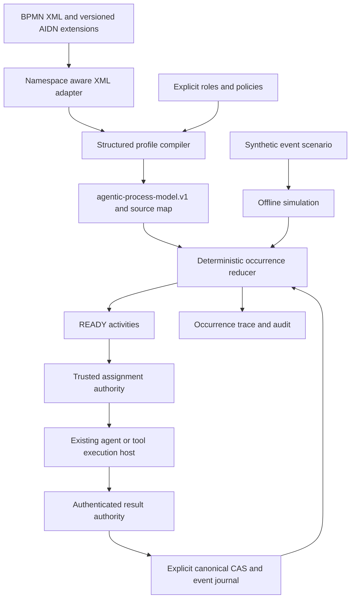

# BPMN to executable AIDN processes

The default profile documented here remains `aidn-bpmn-structured.v1`.
The explicit [v2 profile](BPMN_EXECUTION_PROFILE_V2.md) additionally compiles
correlated message races, post-test guarded loops, fixed multi-instance
collections and same-participant local procedure calls into the existing IR.

## Architecture

BPMN is the modeling and interchange language. `agentic-process-model.v1` is
the canonical executable representation (IR). `agentic-process-instance.v1`
retains the pinned model, policies and ordered event history. Compilation is
explicit and in memory; neither loading XML nor simulating grants execution.



| Concept | Owning implementation | Responsibility |
| --- | --- | --- |
| BPMN syntax | `src/adapters/workflow/bpmn-xml.mjs` | Strict XML parsing, namespaces and resource limits |
| BPMN execution profile | `src/core/workflow/bpmn-profile.mjs` | Version and fixed diagnostic codes |
| Structured translation | `src/core/workflow/bpmn-process-compiler.mjs` | Check graph, match split/join scopes, emit validated IR and source map |
| Compilation composition | `src/application/workflow/bpmn-process-service.mjs` | Supply XML adapter and exact source fingerprint to pure compiler |
| IR and capabilities | `src/core/workflow/agentic-process-model.mjs` | Closed model, role/policy references, bounds and executable constructs |
| Tokens and occurrences | `src/core/workflow/agentic-process.mjs` | Same deterministic reducer for inspection, execution and simulation |
| Simulation | `src/core/workflow/agentic-process-simulation.mjs` | Replay explicit synthetic events with a cursor after every step |
| Resource eligibility | `src/core/agents/agent-reuse-policy.mjs` | Compatible reuse, contributor exclusion, context and permission rules |
| Trusted execution | `src/application/runtime/agentic-process-service.mjs` | Authority, binding, assignment-before-dispatch and authenticated result checks |
| Native composition | `src/application/runtime/agentic-process-execution-composition.mjs` | Existing activated-project host and native adapter |
| Canonical journal | `src/adapters/runtime/agentic-process-store.mjs` | Existing backend, explicit write, scope fence and CAS |

A pool is a logical participant, a lane a responsibility, and an agent an
identified resource. An AND split activates branches; it never creates agents.
Independent review remains an activity with a policy, including contributor
exclusion. Reconciliation of branch outputs requires an explicit activity.

## Published profile: aidn-bpmn-structured.v1

The compiler accepts one process with `isExecutable="true"`, one untyped start,
one untyped end, and a structured acyclic graph. It checks XML syntax and this
profile, **not full OMG XSD conformance**. Its successful output must also pass
the existing executable IR schema and semantic validator.

| Construct | XML compiler | IR execution and event simulation |
| --- | --- | --- |
| Task, serviceTask, userTask | Explicit role/policy extension; one incoming and outgoing flow | Activity, assigned by existing host |
| Sequence flow | Explicit, same process; optional incoming/outgoing declarations must agree | Structured sequence |
| Exclusive gateway | Paired structured split/merge; first true flow in XML flow declaration order | XOR with explicit Boolean facts |
| Parallel gateway | Paired split/join; all distinct branches required | AND with logical concurrency |
| Inclusive gateway | Paired structured split/join; selected branches only | OR with explicit Boolean facts |
| Start/end | One of each, no event definitions; structural delimiters | Root activation/completion |
| Lanes | Flat laneSet/lanes with checked flowNodeRef references | Responsibility metadata; no executor allocation |
| Diagram interchange | BPMNDiagram subtree ignored for execution | No control semantics |
| Exclusive event race | Refused by XML compiler | Existing correlated host event support |
| Bounded loop, multi-instance, call | Refused by XML compiler | Existing executable and simulable IR primitives |
| Cross-participant messages/review | Refused | Descriptive only; execution refuses |
| Boundary events, durable timers, arbitrary graphs, mixed/complex gateways | Refused | Outside this profile |

`userTask` expresses responsibility; v1 does not introduce a human inbox or
interactive form service. All task types use the same explicitly supplied host
binding. XML does not select an executable, plugin, adapter, module or native tool.
No XML export, editor integration, general BPMN engine or automatic conversion
of the operating-model diagrams in `docs/bpmn/` is provided.

Task binding uses the versioned namespace `urn:aidn:bpmn:execution:v1`:

```xml
<bpmn:task id="Review" name="Independent review">
  <bpmn:extensionElements>
    <aidn:execution roleRef="review" policyRef="review"/>
  </bpmn:extensionElements>
</bpmn:task>
```

The caller supplies the referenced role and policy definitions. XML cannot add
permissions, claim independence or change required policy pins. The existing
trusted deployment must authorize the selected model and policies before real
execution. Matching a model hash proves content identity, not authorization.

Conditional flows contain a single Boolean fact name, never executable code:

```xml
<bpmn:sequenceFlow id="Passed" sourceRef="Decision" targetRef="Review">
  <bpmn:conditionExpression language="urn:aidn:bpmn:execution:v1">tests_ok</bpmn:conditionExpression>
</bpmn:sequenceFlow>
```

Only XOR/OR split flows accept conditions. A gateway's optional `default` names
one outgoing flow without a condition. Missing facts wait in the reducer; no
matching branch without a default fails explicitly. If multiple XOR facts are
true, the first matching declared flow wins. This order is part of the profile.
Expressions, `xsi:type` annotations, execution attributes beyond this profile,
unknown extensions and unsupported elements refuse instead of being dropped.

IDs are unique ASCII XML names of at most 128 characters. Generated IR node and
flow IDs are deterministic in document order. `source_map` links each task,
split and matched join to its IR node; generated sequences map to the process.
Start/end are delimiters, without activity occurrences. A simulation occurrence's
`node_id` can therefore be resolved back to the modeled responsibility.

The compiler uses DAG postdominators to find the nearest mandatory convergence,
then validates disjoint structured branch scopes. A shared child, mismatched
gateway, bypass, cycle, implicit join, empty branch or unreachable element
refuses. Diagnostics have fixed `code` and optional `element_id`, for example
`BPMN_STRUCTURED_JOIN_REQUIRED`; raw XML and parser diagnostics are not exposed.

Bounds are 256 KiB XML, 4,096 XML elements, depth 24, 128 flow nodes and 384
flow-node/sequence-flow elements combined. The resulting IR retains its stricter
node, nesting, fan-out and occurrence-path limits. DTDs, custom entities and
external resolution are unsupported. SAX is a locked runtime dependency.

## Using the internal API

```js
import { compileBpmnProcess } from "./src/application/workflow/bpmn-process-service.mjs";
import { agenticPolicyPins } from "./src/core/workflow/agentic-process-model.mjs";
import { simulateAgenticProcess } from "./src/core/workflow/agentic-process-simulation.mjs";

const compiled = compileBpmnProcess({
  xml, modelId: "delivery", revision: 1, participantId: "delivery", roles, policies,
});
const report = simulateAgenticProcess({
  instanceId: "scenario", model: compiled.model,
  policyPins: agenticPolicyPins(compiled.model), scopeId: "simulation",
  facts: { tests_ok: true }, events: [],
});
// With no events, trace[0] shows the first READY activities or routing wait.
// A complete scenario supplies typed assign/result, facts, message or cancel
// events from the existing agentic-process-instance.v1 event vocabulary.
```

Simulation validates every event with `advanceAgenticProcess`, including
assignment/result binding, correlation, event order, failure and idempotence.
The scenario supplies synthetic assignment decisions/results; the simulator does
not authenticate resources or obtain verdicts. It reports `evidence_kind:
synthetic` and `write_authorization:false`, with source-independent model/scenario
hashes and step-by-step cursors. It returns no durable instance. There are no
clock, native execution or persistence ports. Initial facts, policy pins and
event IDs are explicit, so identical inputs reproduce identical traces.

Limits include 512 scenario events, the existing safe-JSON guard, and 4 MiB of
serialized trace rows. Resource estimates, cost, wall-clock timing and capacity
scheduling are not simulated. Roles/skills and observed capability remain host
concerns. An assignment's structural validity is not proof of native eligibility.

For real execution, pass `compiled.model` to the existing
`createAgenticProcessService.initialize` with trusted scope/model/policy authority,
or compose the existing owned execution host. Preview remains read-only; writes
still require explicit intent and canonical CAS. Synthetic traces cannot satisfy
those authorities. No new CLI command or installed activation is introduced.

## Information governance and evolution

Authored XML is modeling input, not runtime state authority. Compilation and its
source map are derived in-memory values. Once explicitly initialized, the
instance's pinned IR and event journal are canonical under the existing
`agentic_process_instance` source-of-truth and metadata policies in all modes.
Editing XML never reinterprets an existing instance. Simulation output is
synthetic reference evidence, not canonical execution or release proof. No new
store, table, durable concept or migration is introduced.

The research report's proposed `agentic-process-model.v2` is unnecessary for
this first lossless subset: v1 already expresses its semantics. Future profile
versions can add XML mappings for existing event/loop/multi-instance/call nodes;
the opt-in [v2 profile](BPMN_EXECUTION_PROFILE_V2.md) now implements those mappings.
Executable participant collaboration and durable boundary/timer semantics need
their own message/authority, correlation, clock, cancellation and persistence
contracts before they can be advertised. Neither is approximated with AND.

This architecture follows the report's separation of modeling, IR, execution
state and resource allocation. Its BPMN reference is the official
[OMG BPMN 2.0.2 specification and machine-readable schemas](https://www.omg.org/spec/BPMN/2.0.2).
The [SAX parser documentation](https://github.com/isaacs/sax-js) describes strict
namespace parsing; it is not an XSD validator.

## Verification

`npm run perf:verify-agentic-process` includes tracked compiler refusals,
namespace handling, nested blocks, Boolean routing, source maps, contracts and
BPMN → IR → reducer → simulation parity. The end-to-end fixture activates two
parallel obligations, permits compatible reuse, refuses author self-review and
completes with a separate eligible reviewer. The existing trusted-host/store and
native-wire-double checks run in the same gate. No new model call is needed.

The example XML in `tests/fixtures/agentic-process/structured-delivery.bpmn` is
a semantic test corpus without diagram coordinates. It has not been visually
qualified in a BPMN editor. Fixtures do not qualify native execution of a newly
compiled model, real PostgreSQL behavior, an installed archive or human review.
See [ADR-0023](ADR/ADR-0023-bpmn-execution-profile-and-simulation.md).
