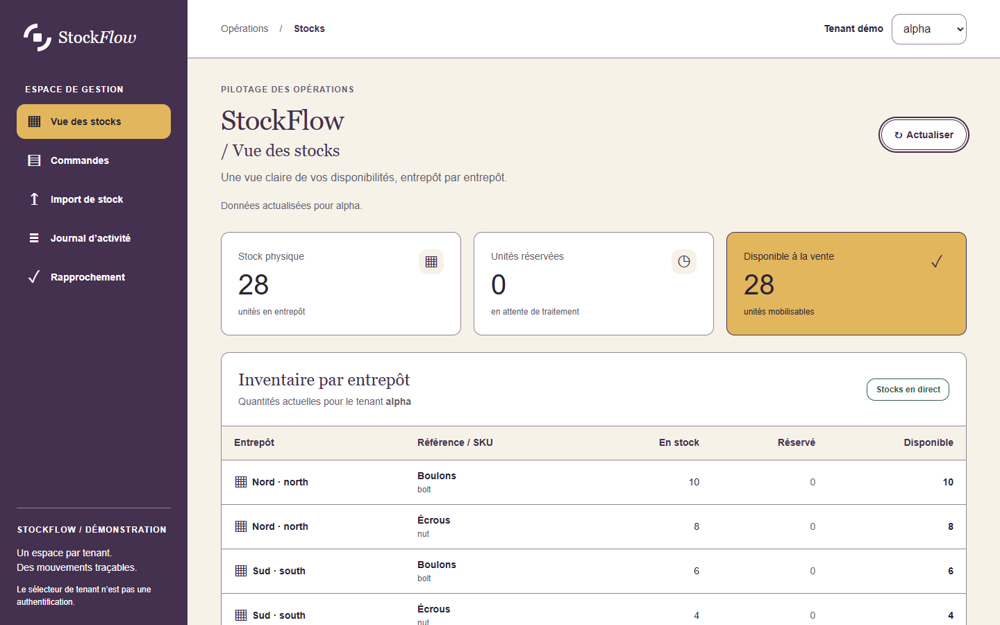
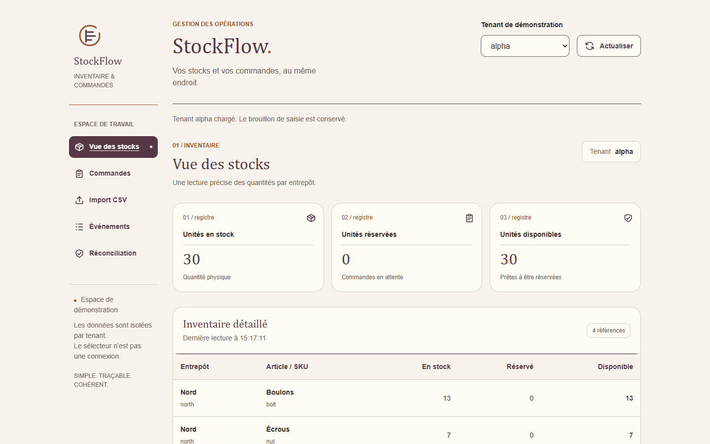

# StockFlow : ce que les benchmarks montrent d'AIDN 0.19.0

Rapport consolidé au 1er novembre 2026. Il rassemble les résultats du backend
PostgreSQL, de l'interface, de la création des identités et de leur application.
StockFlow est une application fictive de gestion de stocks multi-sites et
multi-tenant. Les données affichées sont des données de démonstration.

AIDN 0.19.0 commence à montrer son intérêt sur un travail qui dépasse le petit
exercice de codage. Son moteur agentique opt-in a piloté une installation
temporaire, plusieurs activités compatibles dans un même contexte, puis une
revue dans un contexte indépendant. Les applications produites passent les
contrôles fonctionnels communs. Sur les étapes d'interface, les exécutions AIDN
retenues ont aussi consommé moins de tokens que celles sans AIDN.

Le résultat est encourageant, avec un contre-exemple à garder en vue : le backend
a consommé 9,7 % de tokens de plus avec AIDN. Les campagnes comprennent des arrêts
et des compléments. Elles montrent un profil utilisable et des signaux
d'efficacité, sans établir un gain général de productivité.

## Lire les résultats

Le [jeu de mesures](mesures.json) contient les compteurs et les horloges utilisés
ici. L'[index des sources](sources.json) identifie les reçus originaux par leur
empreinte SHA-256. Ces archives sont conservées par l'opérateur ; les journaux
bruts, les identités d'exécution et les chemins privés ne sont pas publiés.
Le lecteur dispose des extraits dans le dépôt, pas d'un dossier autonome pour
rejouer les expériences.

Les deux bras emploient `gpt-6.1-sol`, avec l'effort `high`. Le bras A utilise
AIDN 0.19.0, son moteur agentique opt-in et PostgreSQL pour la gouvernance. Le
bras B utilise un lanceur externe, sans client ni workflow AIDN activé dans son
projet. Les applications StockFlow utilisent PostgreSQL dans les deux bras.
Chaque étape repart de sa base prévue ; les phases suivantes reprennent les
livrables figés qui leur sont destinés.

Le lanceur commun impose aussi des contrôles au bras B : réutilisation du
contexte auteur pour les activités compatibles, revue séparée et oracles
communs. La comparaison porte donc sur AIDN face à un dispositif sans AIDN déjà
encadré. Elle ne mesure pas le bénéfice d'une revue indépendante face à une
absence de revue.

Aucun de ces contrastes ne dispose d'un état initial du fournisseur et du cache
établi identique. Les essais ne sont ni répétés ni contrebalancés. Leurs écarts
restent descriptifs, même quand le brief et les contrôles sont communs.

Les mentions ont un sens précis : OBSERVÉ désigne une donnée conservée dans un
reçu ; CALCULÉ, une opération sur ces données ; HYPOTHÈSE, une explication encore
à établir ; NON MESURÉ, une donnée absente ; RÉFUTÉ, une interprétation contredite
par une vérification. Un verdict automatique et un choix humain restent deux
résultats distincts.

## Vue d'ensemble

Les tokens de ce tableau comprennent les étapes nécessaires au résultat retenu,
y compris les compléments B des lignes backend et UI. Les tentatives antérieures
interrompues sont comptées à part plus bas.

| Étape | AIDN : tokens observés | Sans AIDN : tokens observés | Réponses A / B | Résultat technique final |
| --- | ---: | ---: | ---: | --- |
| Backend PostgreSQL | 1 145 213 | 1 043 655 | 23 / 27 | 28/28 contrôles et revue acceptée dans chaque bras |
| Interface fonctionnelle | 891 139 | 1 071 949 | 19 / 27 | 20/20 contrôles et revue acceptée dans chaque bras |
| C1 : création des identités | 1 161 092 | 1 106 049 | 24 / 33 | 8/8 contrôles et revue acceptée dans chaque bras |
| C2 : application des identités | 1 470 339 | 2 056 833 | 24 / 26 | 20/20 fonctionnels, 8/8 identité et revue acceptée dans chaque bras |

Pour C1, A décrit la reprise terminée ; B comprend plusieurs reprises de revue.
Pour C2, A a reçu ses derniers contrôles graphiques lors d'une vérification locale
ultérieure sans modèle, sur ses fichiers inchangés. Ces différences empêchent de
lire le tableau comme quatre expériences A/B parfaitement contrôlées.

### Les durées, avec leurs frontières

| Étape | AIDN | Sans AIDN | Lecture correcte |
| --- | --- | --- | --- |
| Backend | 17 min 52,613 s de workflow ; 16 min 36,338 s de natif | 17 min 32,144 s de natif reconstitué ; 34 min 02,954 s jusqu'à la fin du complément | La somme native B ne constitue pas un workflow continu. L'attente ne devient pas un gain AIDN. |
| UI | 11 min 57,685 s de workflow ; 10 min 49,497 s de natif | 17 min 07,452 s initiales, puis 2 min 11,751 s de complément | 19 min 19,203 s est une reconstruction active ; le calendrier B atteint 68 min 17,242 s. |
| C1 | 15 min 17,283 s pour la reprise terminée | 22 min 48,804 s cumulées | Les reprises et les budgets diffèrent. L'essai A interrompu précède cette durée A. |
| C2 | 12 min 50,616 s de natif auteur et revue | 15 min 13,792 s de natif auteur et revue | Ces horloges excluent les oracles et les préparations. Ce sont les durées comparées ci-dessous. |

## 1. Backend : un résultat fonctionnel, avec un surcoût de tokens

Le cas demande une API transactionnelle multi-tenant : stocks, commandes,
réservations, idempotence, import CSV, événements et rapprochement. L'oracle
commun vérifie 28 obligations. Les deux productions les satisfont et reçoivent
une revue de source acceptée.

La décomposition des tokens permet de voir où l'effort s'est porté :

| Activité | AIDN | Sans AIDN |
| --- | ---: | ---: |
| Analyse | 32 222 | 14 603 |
| Implémentation, incrément du même contexte auteur | 903 801 | 819 349 |
| Revue indépendante | 209 190 | 209 703 |
| Total | 1 145 213 | 1 043 655 |

CALCULÉ : AIDN consomme ici 101 558 tokens de plus, soit 9,7 %. Ses entrées hors
cache sont plus faibles, 93 604 contre 110 628, mais cette observation ne suffit
pas à calculer une facture. Aucun prix ni montant fournisseur n'a été mesuré.

Le lot initial s'est arrêté sur `UNDECLARED_PRODUCT_DIRECTORY`. Node avait créé
un cache de compilation dans le produit. La revue et l'oracle B ont ensuite été
terminés sous une autorisation distincte, sur les dix fichiers inchangés, sans
refaire le codage. Ce complément ajoute 209 703 tokens et sept réponses, déjà
inclus dans la colonne B.

Les 42 tests générés avec AIDN et les 104 sans AIDN décrivent les suites livrées.
Leur nombre ne classe pas la qualité. Les 151 requêtes de l'oracle par bras
exercent des scénarios fonctionnels, y compris des erreurs et de la concurrence ;
leurs latences ne qualifient pas un débit ou une charge de production.

Source principale : `backend` dans [l'index](sources.json).

## 2. UI : moins de tokens, avec une friction de revue à isoler

Les deux interfaces rendent les mêmes fonctions accessibles : changement de
tenant, stocks, commandes, import, événements et rapprochement. Elles passent
20/20 contrôles communs. Les revues indépendantes finissent acceptées.

OBSERVÉ : AIDN utilise 891 139 tokens, contre 1 071 949 pour B. CALCULÉ : l'écart
est de 16,9 % en faveur de l'exécution AIDN retenue. Toutefois, B comprend
81 255 tokens de friction identifiée : 48 652 pour une revue bloquée par l'accès
aux fichiers et 32 603 pour qualifier cet accès. Il reste 990 694 tokens pour la
génération et la revue finalement acceptée. Face à cette partition, l'écart
descriptif est de 10,0 %. Les deux lectures sont conservées.

Le complément B lit effectivement les neuf fichiers, puis rend son verdict sans
modifier le produit. Ses neuf réponses et ses 313 763 tokens sont inclus dans le
total B ; le contrôle d'accès et le verdict partagent un seul nouveau contexte de
relecture. Ils ne sont pas additionnés une seconde fois.

Le statut initial `QUALITY_FAIL` masquait une revue incomplète pour accès refusé.
Ce statut ne prouvait pas une mauvaise interface. La consolidation conserve
aussi un écart à la règle d'arrêt initiale ; l'autorisation du complément ne
valide pas rétroactivement cet écart. Les temps d'attente et les corrections du
lanceur appartiennent au bilan de campagne.

Source principale : `ui` dans [l'index](sources.json).

## 3. C1 : produire des directions puis laisser le choix à l'utilisateur

Le brief vise des entreprises multi-sites, avec une identité fiable, structurée
et premium. Chaque bras conçoit deux directions : stratégie, symboles et
déclinaisons SVG, couleurs, typographie, guides et planches HTML/CSS. Le
relecteur doit accéder aux vingt fichiers avant de rendre un avis de qualité.

Les deux kits passent 8/8 contrôles et leur revue technique. L'utilisateur
sélectionne ensuite Relais pour AIDN et Cadence pour le bras sans AIDN. Cette
validation H1 porte sur une direction à appliquer. Elle ne désigne pas un
vainqueur esthétique et ne vaut pas acceptation des futures interfaces.

La reprise AIDN terminée consomme 1 161 092 tokens en 24 réponses. Un essai A
précédent conserve 65 273 tokens observés, avec une consommation supplémentaire
inconnue et un résumé de worker manquant. Le minimum observé pour A est donc
1 226 365 tokens. B cumule 1 106 049 tokens et 33 réponses, avec plusieurs reprises
de relecture. Les budgets inégaux empêchent d'en faire une comparaison
d'efficacité à conditions égales.

Deux autres limites restent dans le dossier : B a dépassé son plafond initial
de vingt minutes de 35,246 secondes avant l'amendement ultérieur ; les octets du
premier export de gouvernance ont été perdus lors d'une reprise. L'export de
remplacement épinglé ne restaure pas cet original. Les fichiers de conception,
la revue finale et les captures restent, eux, vérifiés.

Source principale : `c1` dans [l'index](sources.json).

## 4. C2 : appliquer les identités sans perdre les fonctions

Cette étape reprend chaque interface figée et lui applique l'identité choisie.
AIDN reçoit Relais ; le bras B reçoit Cadence. Les contrôles doivent retrouver
les vingt obligations fonctionnelles et vérifier huit obligations d'identité.

Le premier oracle graphique ne reconnaissait pas une variante approuvée du
logo. Il a refusé A et provoqué l'arrêt de B. RÉFUTÉ : ce refus ne prouvait pas
l'absence de logo dans le produit A. La correction a élargi le sélecteur aux
variantes déjà prévues par le contrat, sans diminuer les exigences. Le contrôle
local ultérieur sur les seize fichiers A inchangés établit 20/20 fonctionnels et
8/8 graphiques. Il prend 95,925 secondes, préparation et contrôles compris, sans
nouvel appel modèle A.

B a ensuite été recodé depuis sa base UI d'origine, sous une nouvelle
autorisation. Il passe à son tour 20/20 et 8/8, avec une revue indépendante ayant
lu les seize fichiers. Son ancien codage interrompu reste conservé séparément.

### Résultats des exécutions retenues

| Mesure | AIDN / Relais | Sans AIDN / Cadence |
| --- | ---: | ---: |
| Entrées | 1 449 703 | 2 018 475 |
| Dont entrées en cache | 1 312 640 | 1 823 488 |
| Entrées hors cache, calculées | 137 063 | 194 987 |
| Sorties | 20 636 | 38 358 |
| Total | 1 470 339 | 2 056 833 |
| Réponses | 24 | 26 |
| Natif auteur et revue | 770 616 ms | 913 792 ms |
| Fonctionnel / identité | 20/20 et 8/8 | 20/20 et 8/8 |
| Revue indépendante | Acceptée | Acceptée |
| Verdict visuel humain final | NOT_RUN | NOT_RUN |

CALCULÉ : A utilise 586 494 tokens de moins, soit 28,5 %, et son temps natif
auteur-revue est inférieur de 143,176 secondes, soit 15,7 %. Ce sont les signaux
les plus favorables de cette campagne. Le workflow initial A dure 13 min
59,648 s, celui de B 15 min 29,672 s ; la vérification graphique A étant
postérieure, cet écart de workflow n'est pas un gain complet à l'acceptation.

Les limites sont concrètes : les bases UI font respectivement 57 696 et
101 004 octets ; les identités diffèrent ; les états initiaux du fournisseur et
du cache ne sont pas établis identiques. Les résultats montrent donc un écart
entre ces exécutions, sans isoler un effet causal du moteur ou de la
réutilisation de contexte. Le bras B bénéficie lui aussi de cette réutilisation.

Les deux exécutions retenues totalisent 3 527 172 tokens. Avec les 759 928 tokens
observés de l'ancien B interrompu, le compteur atteint 4 287 100. Ce minimum
conservé n'est pas le coût complet : la consommation B en vol, les interventions
dans la CLI et celle du chat de préparation restent inconnues ou non mesurées.

### Les interfaces produites

AIDN, direction Relais :

Sans AIDN, direction Cadence :

Ces captures proviennent des oracles, sans retouche. Elles illustrent les
livrables à des instants différents, avec des états de données différents.
L'appréciation visuelle finale appartient à l'utilisateur ; les scores
automatiques ne la remplacent pas.

Sources : `c2`, `c2_original`, `c2_correction`, `c2_retained_a` et `c2_seal`
dans [l'index](sources.json).

## Les arrêts et les coûts qui restent au bilan

| Passage | Résultat conservé | Consommation ou limite à conserver |
| --- | --- | --- |
| Préparation backend initiale | Défaut de chemin avant benchmark natif | Aucun appel modèle de benchmark démarré ; coût du chat non mesuré |
| Premier lot backend opt-in | `PROCESS_ACTIVITY_FAILED` ; le modèle rapporte `GLOBAL_RUNTIME_ACCESS_DENIED` | 86 763 tokens et trois réponses ; éventuelle consommation en vol inconnue ; cause précise non établie indépendamment |
| Backend terminé par complément | Arrêt initial `UNDECLARED_PRODUCT_DIRECTORY`, puis revue/oracle B autorisés à part | Les 209 703 tokens du complément sont inclus dans B ; aucun recodage |
| Premier lot UI | `HUMAN_ACK_CHANGED`, avant les essais modèle | 11 min 06,393 s de préparation et d'attente ; aucun essai modèle de benchmark |
| UI : revue B | Accès refusé, puis accès et revue qualifiés à part | 81 255 tokens de friction identifiée, inclus dans B ; écart initial à la règle d'arrêt conservé |
| Prévol C1 initial | `FINAL_PREFLIGHT_REFERENCE_ERROR` | 35 min 34,206 s avant préparation des essais ; coût du chat non mesuré |
| C1 : reprises | Revue B retardée, A interrompu par le seuil de stockage, puis compléments autorisés | 65 273 tokens A connus en plus, consommation restante inconnue ; dépassement B initial de 35,246 s |
| Premier lot C2 | `HUMAN_ACK_CHANGED`, avant les essais | Aucun essai auteur/relecteur ; l'approbation interactive n'est pas une mesure de consommation |
| C2 : oracle initial | Refus erroné d'une variante de logo ; lot fermé | 759 928 tokens B observés, réponses finales et consommation en vol inconnues ; aucun remplacement silencieux |
| C2 : vérification A et nouveau codage B | A inchangé revérifié sans modèle ; B neuf terminé | Les 95,925 s de contrôle A restent séparées ; B est un nouveau lot, pas une réparation du premier résultat |

Une partie des incidents vient du banc d'essai : chemins, reçus, accès du
relecteur, collecte et oracle. Ces corrections améliorent la mesure ; elles ne
constituent pas toutes des progrès du produit AIDN. Quand la cause n'est pas
établie, le rapport conserve l'inconnue au lieu de blâmer le produit ou le modèle.

Le temps global comprend installation, attente humaine et fermeture selon chaque
autorisation. La levée ultérieure du quota global de stockage ne retire pas les
arrêts antérieurs. Pour C1, le débit cumulé incluait les PostgreSQL temporaires
déjà retirés ; il différait donc de l'espace encore occupé sur disque.

Le nouveau B C2 termine son workflow en 15 min 29,672 s, sous son plafond de
25 minutes et 60 réponses. Ses 26 réponses restent sous ce plafond. Son
scellement final, rapport inclus, intervient à 29 min 46,608 s, sous les
40 minutes autorisées. Les ressources de validation sont fermées. Les serveurs
de démonstration ouverts à la demande de l'utilisateur ont une fonction séparée.

## Ce qui a progressé dans la version courante

### Un processus agentique exécuté et contrôlé

La version 0.19.0 apporte un modèle explicite d'activités, de rôles et de
passerelles. Dans les cas natifs couverts ici, analyse et implémentation partagent
un contexte auteur, puis la revue utilise un contexte neuf en lecture seule.
L'identité de l'exécution, ses droits et son rôle restent distincts. Cette
séparation est désormais un comportement observé dans le profil testé.

L'intérêt pratique est d'embarquer ces règles dans le runtime du projet. Le bras
sans AIDN doit recevoir ses règles équivalentes du lanceur externe. Le temps
nécessaire pour développer et maintenir ce lanceur n'a pas été mesuré comme un
gain AIDN.

### Une portée plus large que le premier service de réservation

La [qualification préalable](../../agentic-process/v0.19.0.md) couvrait un service
Node/SQLite, avec PostgreSQL pour la gouvernance. StockFlow ajoute une API
PostgreSQL transactionnelle, une interface, des identités et leur application.
L'installation AIDN est temporaire et effective. Le profil opt-in reste
explicite ; les résultats ne concernent pas automatiquement le workflow installé
par défaut.

Les preuves natives restent celles d'un participant séquentiel, avec auteur et
relecteur distincts. Elles ne qualifient pas toutes les passerelles, une
concurrence distribuée ou le confinement hostile du client complet. Les
garanties de contexte neuf et d'outils restreints ne valent pas isolation totale
du système d'exploitation.

### Des premiers signaux d'économie sur le travail d'interface

L'UI puis C2 donnent des résultats favorables sur les tokens des exécutions
retenues. C2 présente aussi une durée native auteur-revue plus courte. La qualité
fonctionnelle commune reste au niveau attendu dans les deux bras. Cela rend
le profil intéressant pour des travaux où l'on veut conserver une revue séparée
tout en faisant enchaîner plusieurs activités à l'auteur.

Le backend plus coûteux en tokens et les reprises C1 empêchent d'étendre ce
constat à tout projet. L'explication « AIDN économise grâce à la réutilisation »
reste une HYPOTHÈSE : le lanceur B réutilise aussi son auteur. Les différences
de code initial, de design et de contexte peuvent contribuer aux écarts.

## Références historiques et portée de la conclusion

Les anciens cas restent accessibles dans les [rapports du 20 octobre](../README.md)
et dans la [qualification de publication 0.19.0](../../agentic-process/v0.19.0.md).
Les comparaisons 034/036, antérieures au moteur agentique courant, montraient
des durées et des consommations nettement défavorables à AIDN. L'essai 035 était
incomplet. Ces cas ne sont pas retirés et ne deviennent pas comparables à
StockFlow : tâches, versions candidates, applications et contextes diffèrent.

La révision 006 avait atteint l'implémentation, puis échoué avant la revue
effective : 734 967 tokens observés, validation de workflow non obtenue. La
révision 010 avait ensuite terminé le cas de réservation, oracle 20/20, avec
779 103 tokens, vingt réponses et 947,723 secondes jusqu'à la fermeture de
l'oracle. Le candidat de publication suivant avait conservé un arrêt
`STORAGE_UNVERIFIABLE`, puis terminé un essai à 857 482 tokens et 22 réponses.
Ces observations documentent la progression de la qualification ; elles ne
forment pas une courbe de performance entre versions.

Les investigations antérieures de capture, de cache ou de représentation des
résultats d'outils restent closes dans leurs dossiers. Elles ne sont ni reprises
ni comptées comme des benchmarks StockFlow. Aucun ancien contraste A/B ne gagne
une validité causale par cette consolidation.

À ce stade, AIDN 0.19.0 a démontré qu'il peut conduire ce profil de travail
agentique jusqu'à des livrables vérifiés, avec une réutilisation encadrée et une
revue séparée. C'est le progrès établi. Les étapes d'interface donnent une
raison mesurée de poursuivre son usage dans ce périmètre. Une supériorité
générale en qualité, un gain global de temps et un gain financier restent
NON MESURÉS ou non validés.

Cette publication consolide les preuves existantes. Elle ne lance ni nouvel
essai ni nouvelle installation.
